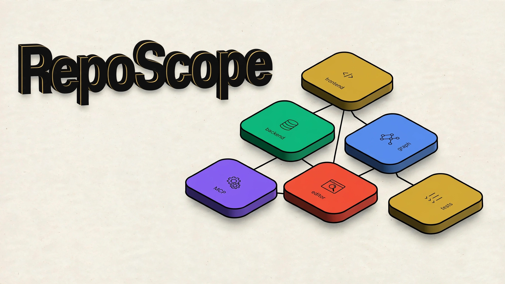
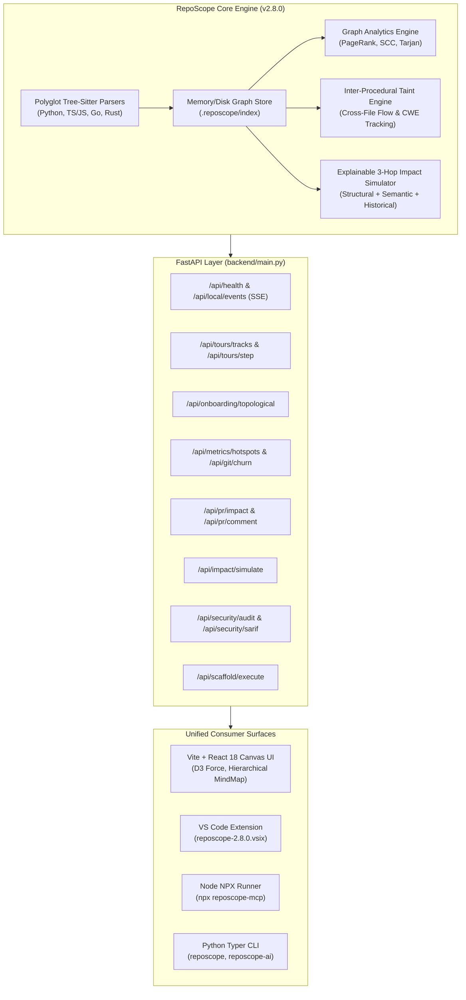
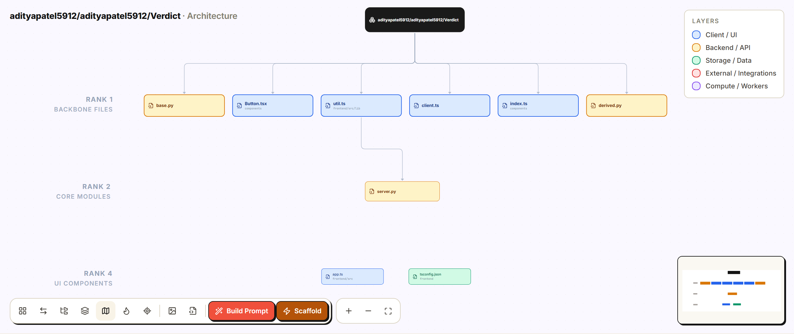
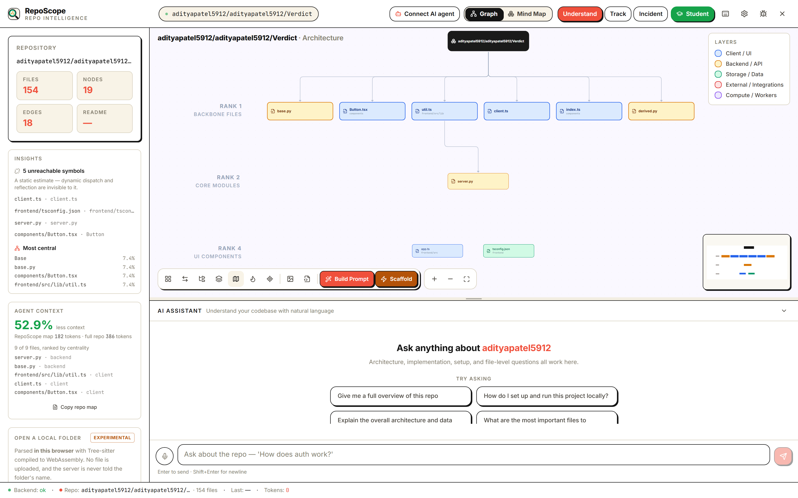
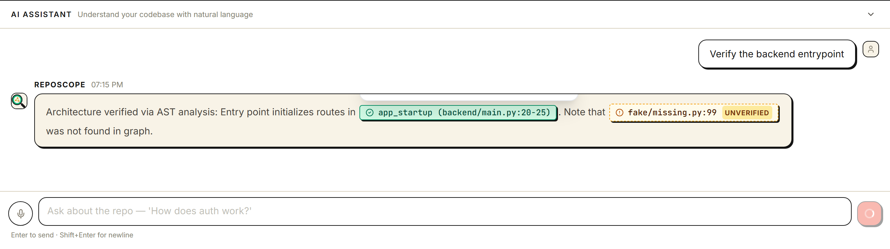
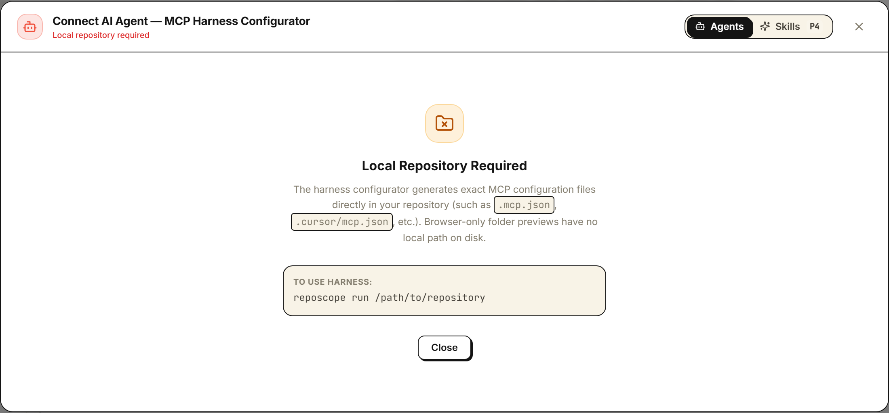

# RepoScope

> **The Code Graph Engine for Humans and Agents, Over One Shared Index.**

[](pyproject.toml)
[](LICENSE)


RepoScope builds a high-fidelity **Tree-sitter polyglot code graph** from a local workspace or remote GitHub repository, serving a single shared knowledge index across four unified interfaces:

1. **The Interactive Architecture Canvas**: D3 Force directed graph, hierarchical collapsible MindMap V2, interactive blast radius simulator, and multi-track architectural tour player.
2. **The Terminal CLI (`reposcope`, `reposcope-ai`)**: Zero-upload local live file watcher, instant graph indexer, inter-procedural security auditor, and MCP server.
3. **The Model Context Protocol (MCP) Server (`reposcope-mcp`, `npx reposcope-mcp`)**: Native tools and resources providing real-time code graph intelligence directly to Claude Desktop, Cursor, OpenCode, and autonomous agents.
4. **The Editor Extension (VS Code, Cursor, VSCodium)**: Live Activity Bar architecture mini-map, CodeLens caller counts, and status-bar blast radius risk gauges.

In local mode, **zero repository code is ever uploaded**. No cloud account, no personal access tokens, and no third-party telemetry.



---

## Architectural Philosophy: The Single Index

Understanding a complex codebase traditionally demands brute-force token consumption: an agent or engineer reads dozens of files, guesses call hierarchies, hallucinates interface boundaries, and re-computes blast radius on every commit.

RepoScope resolves this at the compiler level. By parsing code into an interconnected abstract syntax graph—with symbol-level call edges, inheritance chains, and inter-procedural data flows—RepoScope replaces brute-force LLM context with deterministic, graph-native queries.



Every surface reads the **exact same index**. A human inspecting a blast radius in the canvas, a terminal user running `reposcope security`, and an autonomous agent querying `reposcope-mcp` receive identical, mathematically consistent insights.

---

## Core Capabilities & Deep Dive

### 1. Six-Engine Graph-Contextual Security Suite
RepoScope combines deep AST pattern matching with inter-procedural taint flow analysis into an offline, zero-hallucination security audit engine:

- **Engine 1: Cross-File Taint Engine**: Tracks tainted input sources (`request.args`, `request.json()`, `sys.argv`) across module imports and function calls into dangerous execution sinks (`subprocess.Popen`, `cursor.execute`, `eval`).
- **Engine 2: High-Entropy Secret Hunter**: Scans code and configs for credentials, private keys, and API tokens using Shannon entropy scoring ($H \ge 4.2$). Enforces strict `<redacted>` masking in memory, logs, and API payloads.
- **Engine 3: Offline Dependency CVE Scanner**: Scans manifest files (`pyproject.toml`, `requirements.txt`, `package.json`) against a curated local CVE database (FastAPI, aiohttp, cryptography, requests, etc.) without external network dependencies.
- **Engine 4: AST Injection Sink Detector**: Tree-sitter powered detection of unparameterized SQL formatting, shell interpolation (`shell=True`), code evaluation, and path traversal vulnerabilities.
- **Engine 5: Insecure Configuration Scanner**: Identifies wildcard CORS rules (`allow_origins=["*"]`), disabled TLS certificate checks (`verify=False`), and production debug flags.
- **Engine 6: Route Auth Bypass Guard**: Detects unauthenticated state-mutating HTTP endpoints (`POST`, `PUT`, `DELETE`, `PATCH`) missing authentication dependencies or authorization decorators.
- **Automated Remediation**: Generates non-destructive, AST syntax-verified Unified Diff patches.
- **OASIS SARIF 2.1.0 Export**: Full compliance for CI/CD pipelines, GitHub Code Scanning, and automated compliance gates.

### 2. Explainable 3-Hop Blast Radius Simulator
Predicts the cascading blast radius of proposed edits before writing a single line of code:
- **Hop 1 (Direct Dependents)**: Direct imports and immediate callers.
- **Hop 2 (Transitive Consumers)**: Second-order callers, services, and upstream managers.
- **Hop 3 (System Boundaries & Clients)**: External HTTP API endpoints, background workers, and event subscribers.
- **Git Co-Change Weighting**: Factors historical coupling into blast radius calculation:
  $$\text{CoChangeWeight}(u, v) = \frac{\text{Commits}(u \cap v)}{\sqrt{\text{Commits}(u) \cdot \text{Commits}(v)}}$$
- **Impacted Test Discovery**: Automatically identifies test suites covering the affected blast radius subgraph.

### 3. Symbol-Level PR Impact & Contract Diff
Goes beyond line diffs to detect semantic contract breaks across commits:
- **Tree-sitter Symbol Differencing**: Identifies deleted, renamed, or signature-modified functions, methods, and classes.
- **Breaking Change Detection**: Flags added mandatory parameters, changed return types, and removed public interface exports.
- **Automated GitHub PR Commenter**: Generates structured markdown summaries with risk tiers and symbol call chains directly on pull requests.

### 4. Hotspots, Bus Factor & Churn Time Machine
Correlates code graph topology with Git commit history to surface architectural risks before they cause production outages:
- **Risk Score Formula**:
  $$\text{Risk}(v) = \text{PageRank}(v) \times \ln(1 + \text{Churn}(v)) \times \frac{1}{\text{BusFactor}(v)}$$
- **Bus Factor Entropy**: Computes effective contributor count via Shannon diversity entropy:
  $$\text{BusFactor}(v) = \exp\left(-\sum_{i=1}^{k} p_i \ln p_i\right)$$
- **Git Churn Time Machine**: Compares git revisions to highlight newly introduced coupling spikes and architectural drift.

### 5. Topological Onboarding & Interactive Code Katas
Converts the code graph into an optimal reading and learning order based on directed acyclic graph (DAG) dependencies:
- **Kahn's Topological Sorting**: Eliminates circular confusion by structuring files into logical tiers:
  - **Tier 1 (Foundations)**: Leaf primitives, data models, schemas, and pure utility functions.
  - **Tier 2 (Core Business Logic)**: Intermediate domain services consuming Tier 1 primitives.
  - **Tier 3 (Application Boundary)**: Controllers, HTTP routers, and CLI entry points.
- **Interactive Katas**: Self-evaluating architectural quizzes and code challenges validating repository understanding.

### 6. Architectural Guided Tours & Universal Chat Action Cards
- **Curated Tour Tracks**: Step-by-step interactive walkthroughs across key subsystems (e.g., "Request Lifecycle", "Data Ingestion Pipeline", "Authentication & Security").
- **Voice Narration**: Integrated Web Speech API and ElevenLabs TTS synthesis for hands-free codebase audio guides.
- **Universal Chat Action Cards**: Context-aware intent detection in chat conversations emitting one-click interactive action cards (`[Launch Tour]`, `[Open Security Audit]`, `[Download SARIF]`, `[Run Simulator]`).

### 7. Interactive Architecture Scaffolder
- **Deterministic Starter Kits**: Generates standard production architectures (Clean Architecture, Ports & Adapters, Modular Monolith, Microservice Core).
- **Non-Destructive Generation**: Generates typed boilerplate, architecture `README.md` documentation, and build manifests with visual previews and copy-paste terminal commands.

### 8. Reverse Prompt Compiler
Compiles repository subgraphs into dense, high-signal prompt templates for AI coding agents:
- `context`: Comprehensive topological overview with structural dependencies.
- `rebuild`: Green-field reproduction specification detailing interfaces and invariants.
- `spec`: Formal API contracts and schemas for test-driven development.
- `feature`: Targeted context slice designed for ticket implementation without context window bloat.

### 9. MindMap V2 Collapsible Hierarchy
Dynamic D3 hierarchical tree layout offering instant structural clarity:
- Seamless switching between Horizontal (Left-to-Right) and Vertical (Top-to-Bottom) layouts.
- Dynamic subtree expanding, collapsing, and directory-level clustering.
- Real-time search highlighting matching files and modules across deep directory nests.

### 10. Verified Chat Citations
- Streams conversational answers with AST-verified file, symbol, and line-range citation pills.
- Interactive hover tooltips displaying instant code previews, line ranges, and direct navigation links into the visualizer canvas and local editor.

---

## Quick Start

### Option 1: Local Mode CLI (Zero-Upload & 100% Offline)

```bash
# Clone and install in editable mode
git clone https://github.com/adityapatel5912/RepoScope.git
cd RepoScope
pip install -e .

# Launch RepoScope on any repository
cd /path/to/target/repo
reposcope run .
```

Open [http://127.0.0.1:4100](http://127.0.0.1:4100). The CLI starts the live file watcher, builds the graph index, and serves the UI. Edit any file in your editor, and the graph updates live without refreshing.

### Option 2: Model Context Protocol (MCP) Server

Connect RepoScope's code graph directly to Claude Desktop, Cursor, or OpenCode:

```bash
# Via Python runtime
reposcope-mcp --root /path/to/target/repo

# Or zero-install Node runner
npx reposcope-mcp --root /path/to/target/repo
```

**Claude Desktop Configuration (`claude_desktop_config.json`):**
```json
{
  "mcpServers": {
    "reposcope": {
      "command": "npx",
      "args": ["reposcope-mcp", "--root", "/absolute/path/to/repo"]
    }
  }
}
```

### Option 3: Terminal Security Audit

Run the 6-engine security audit directly in your CI/CD pipeline or terminal:
```bash
# Human-readable vulnerability summary:
reposcope security .

# OASIS SARIF 2.1.0 output:
reposcope security . --sarif > results.sarif
```

### Option 4: VS Code Extension

Install the packaged VSIX extension artifact directly into VS Code or Cursor:
```bash
code --install-extension extensions/vscode/reposcope-2.8.0.vsix
# or for Cursor:
cursor --install-extension extensions/vscode/reposcope-2.8.0.vsix
```

Provides live CodeLens caller counts, status bar blast radius risk gauges, and an in-editor mini-map connected to your local RepoScope daemon.

---

## Measured Context Savings

Traditional AI coding assistants waste 90–99% of their context window reading unrelated files. RepoScope's graph-ranked topological pruning reduces context payloads by up to **99.8%**:

| Repository | Total Files | Graph Nodes | Raw Context | RepoScope Map | Token Reduction |
|---|---:|---:|---:|---:|---:|
| `psf/black` | 544 | 3,753 | 2,006,931 tokens | 7,926 tokens | **99.6%** |
| `Textualize/rich` | 582 | 2,649 | 2,971,154 tokens | 7,920 tokens | **99.7%** |
| `psf/requests` | 159 | 937 | 2,632,160 tokens | 3,989 tokens | **99.8%** |
| `pallets/click` | 207 | 2,256 | 537,806 tokens | 7,840 tokens | **98.5%** |
| `encode/httpx` | 154 | 1,365 | 348,904 tokens | 5,192 tokens | **98.5%** |

---

## Visual Feature Gallery

The following visual gallery showcases key surfaces of RepoScope v2.8.0, captured across our Playwright validation battery at **2x Retina resolution** (`deviceScaleFactor: 2`) with strict component-focused framing. For the complete high-resolution visual index, see [`docs/SHOTS_GALLERY.md`](docs/SHOTS_GALLERY.md).

### 1. Interactive Architecture Graph Canvas
Dynamic visualizer rendering symbol-level nodes, import edges, architectural layer categorizations (Client/UI, Backend/API, Storage/Data, External/Integrations, Compute/Workers), and a real-time React Flow mini-map.



### 2. Student Onboarding Mode (Active Workspace)
TopBar student mode indicator glowing emerald green with pulsating badge. Displays the Kahn DAG topological learning path in the sidebar alongside highlighted entry points on the main architecture canvas.



### 3. Verified Chat Citations with AST Hover Inspection
Conversational AI Assistant with anti-hallucination guardrails. Verified symbols receive green badges (`backend/main.py:20`) with instant hover preview tooltips revealing exact line ranges, symbol signatures, and confidence metrics, while unverified symbols are flagged with caution badges.



### 4. Nine-Agent MCP Harness Configurator Modal
Seamless one-click integration modal configuring RepoScope MCP across 9 major AI coding environments: Claude Code, Cursor, VS Code, Codex CLI, Kiro, Antigravity, Windsurf, Cline, and OpenCode. Previews `.mcp.json` configs and agent skills without modifying user files without consent.



### 5. Six-Engine Graph-Contextual Security Suite
The security dashboard displays deterministic findings categorized across all 6 engines (Taint, Secrets, CVEs, Injections, Configs, Auth), inter-procedural taint propagation flow diagrams, and syntax-verified unified diff patch remediation.


### 6. Explainable 3-Hop Blast Radius Simulator
Simulates the downstream propagation of proposed code changes across direct dependents (Hop 1), transitive consumers (Hop 2), and application boundary endpoints (Hop 3), surfacing affected test suites before commits.


### 7. Symbol-Level PR Impact & Contract Diff
Deep AST inspection comparing base and head revisions to identify breaking function and class signatures, caller blast radius, and automated PR review comment generation.


### 8. Hotspots, Bus Factor & Churn Time Machine
Correlating PageRank graph centrality with commit churn and Shannon entropy author diversity to pinpoint architectural single points of failure.


### 9. Topological Onboarding & Interactive Katas
Kahn's topological sort organizing repository dependencies into progressive learning tiers (Foundations, Business Logic, Application Boundaries) with interactive verification katas.


### 10. Architectural Guided Tours
Step-by-step codebase walkthroughs across 4 specialized execution tracks (`Request Lifecycle`, `Data Flow`, `Blast Radius`, and `Onboarding Guide`). Includes step navigation controls, node highlights, and one-click export to standard VS Code `.tour` JSON.


### 11. Universal Conversational Action Cards
Contextual action buttons embedded directly into the conversational assistant stream. Allows engineers to launch tours, trigger audits, or simulate blast radii directly from AI responses without navigating submenus.


### 12. Executable Clean Architecture Scaffolder
Scaffolds standard production architectures (Clean Architecture, Ports & Adapters, Modular Monolith) with live file tree inspection, boilerplate code preview, and CLI execution commands.


### 13. Four-Mode Reverse Prompt Compiler (Feature Slice)
Compiles repository subgraphs into 4 deterministic prompting modalities (`context`, `rebuild`, `spec`, and `feature`) for AI coding agents. Slices deterministic 2-Hop Interface Closures with contract tables and token budget estimation.


### 14. Hierarchical MindMap V2
Collapsible D3 hierarchy providing dynamic Left-to-Right and Top-to-Bottom structural navigation with instant cluster search and category grouping.


---

## Documentation Index

| Document | Purpose |
|---|---|
| [**Hackathon Submission**](docs/HACKATHON_SUBMISSION.md) | Devpost submission story (Inspiration, What it does, How we built it, Challenges, Roadmap). |
| [**Architectural Walkthrough**](docs/WALKTHROUGH_V2.7_V2.8.md) | Comprehensive master walkthrough covering all V2.7 and V2.8 milestones (Phases 5–14A). |
| [**Visual Verification Gallery**](docs/SHOTS_GALLERY.md) | Catalog of all 32 high-resolution UI and feature screenshots. |
| [**API Specification**](docs/API.md) | Complete OpenAPI / FastAPI endpoint contracts, schemas, and payloads. |
| [**MCP Documentation**](docs/MCP.md) | Reference for all 13 Model Context Protocol tools and 8 resources. |
| [**Architecture Guide**](docs/ARCHITECTURE.md) | Deep dive into parsers, graph builder, memory layouts, and event streams. |
| [**Contributing Guide**](CONTRIBUTING.md) | Local environment setup, test instructions, and contribution workflow. |
| [**Code of Conduct**](CODE_OF_CONDUCT.md) | Community pledge, standards, and reporting guidelines. |

---

## License

RepoScope is **source-available**, not OSI Open Source. You may read, run, modify, and use it in your own projects, including internal business projects. You may not republish, distribute, sublicense, sell, or otherwise commercially exploit RepoScope or a modified version without prior written permission from the copyright holder. See [LICENSE](LICENSE) for complete terms.
