# RepoScope

> **One code graph. Four ways in: the canvas, the CLI, an MCP server, and your editor.**

[](LICENSE)


RepoScope builds a **Tree-sitter code graph** from a local folder or a GitHub
repository and serves that one index to humans and agents:

- an interactive **architecture canvas**;
- a **local CLI** that watches a folder and rebuilds as you edit;
- an **MCP server** with 8 tools and 5 resources for Claude, Cursor, OpenCode,
  and any other MCP client;
- a **VS Code / Cursor / VSCodium extension** that puts the graph in the
  Activity Bar.

In local mode **nothing from the repository is uploaded**. No GitHub account,
no personal access token, no clone.


*Generated brand hero. The product screenshots below are captured from the
running app.*

---

## Why it exists

Understanding a repository usually means reading it. An agent that wants to
answer "what breaks if I change this?" reads the whole tree, guesses at the
edges, and pays for the context every time.

RepoScope already has the graph. The canvas renders it; the MCP server hands it
to an agent; the extension shows the neighbourhood of the file you are editing.
Every surface reads the **same index**, so the answer a human sees and the
answer an agent quotes are the same answer.

---

## Screenshots

App screenshots are **1600×900** from the local-mode build; the two OpenCode
client captures keep their native panel size. The full index — including the
older feature gallery — is in
[`docs/SCREENSHOTS.md`](docs/SCREENSHOTS.md).

### The workspace

The RepoScope repository itself. Large repositories open grouped by top-level
module; every file remains reachable in the drawer.


Click a module card to see its files, incoming/outgoing edges, and the actions
that apply to that module.

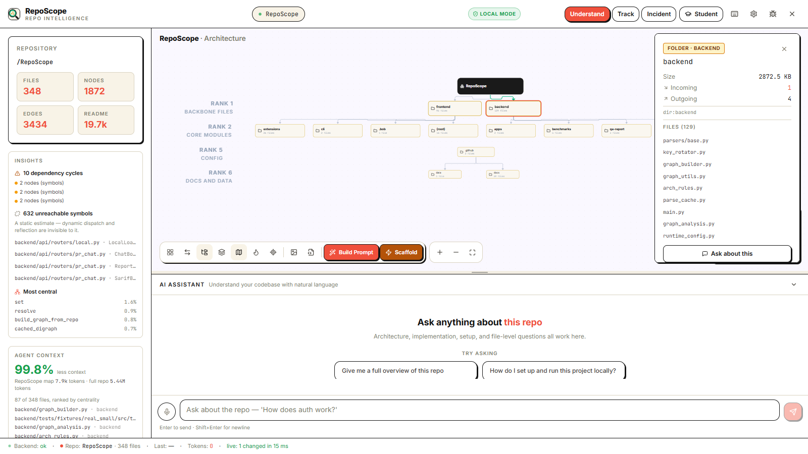

### Graph modes

#### **Grouped by module**

Large-repository view: top-level modules become cards; every file remains
reachable in the drawer.

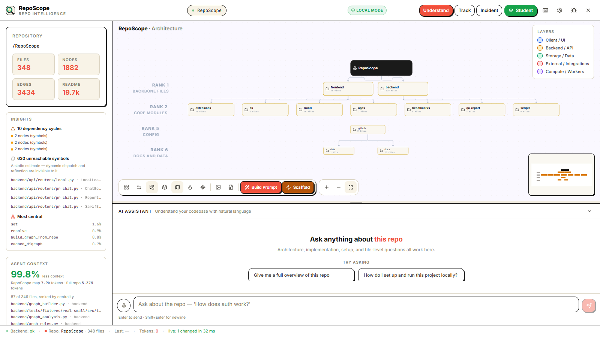

#### **Architecture clusters**

Group by layer: Client/UI, Backend/API, Storage/Data,
External/Integrations, and Compute/Workers.

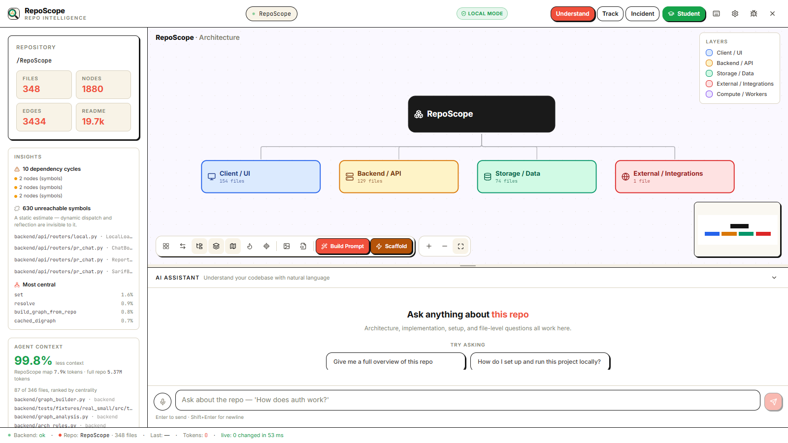

#### **Flat inspection**

Every file node is rendered. Useful for inventory, not a first read of a large
repository.

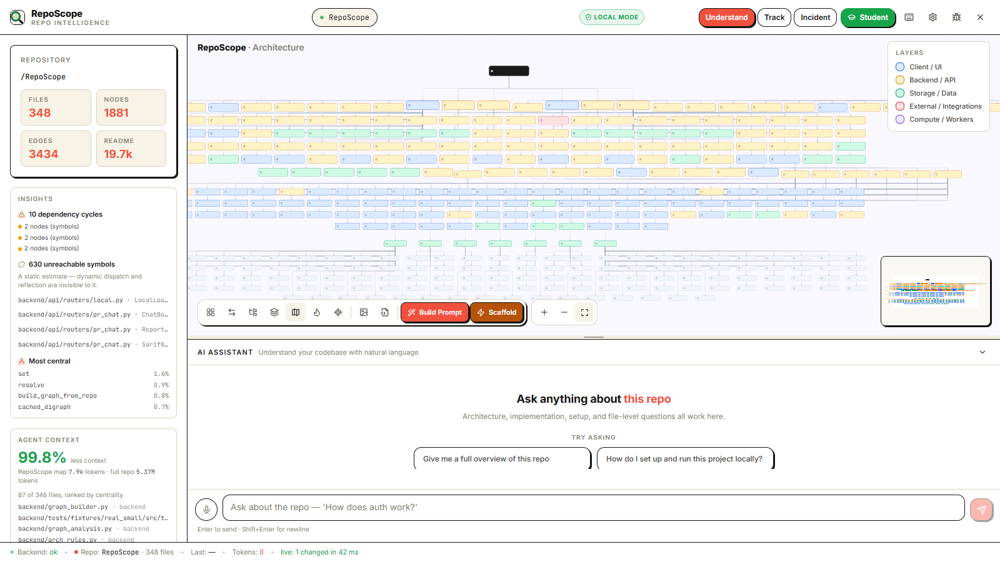

#### **Churn overlay**

Adds the git-history heat signal without replacing the layer colours.

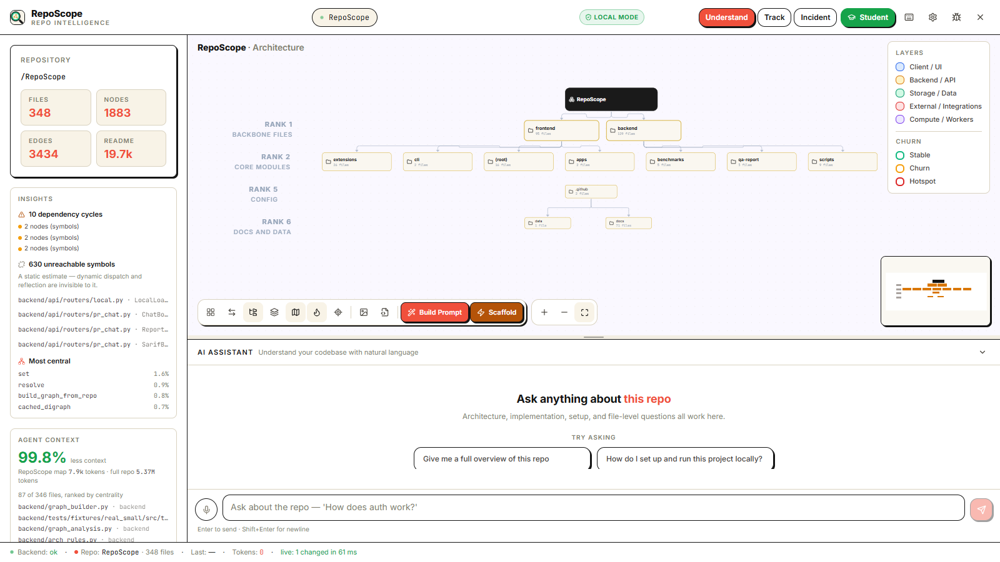

#### **Small repositories**

Use the full connectivity pyramid rather than module cards.

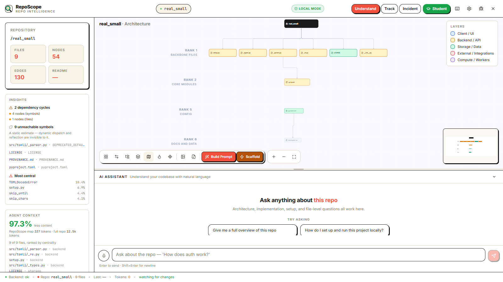

### Side panels

Code Tour, What-If Impact, PR Bot, Quick Actions, and the AI assistant share the
left rail.


#### **Code tour**

Guided tours walk a module step by step and keep the graph in sync.


#### **What-If Impact**

Ask for a target and a depth, then highlight the blast radius.

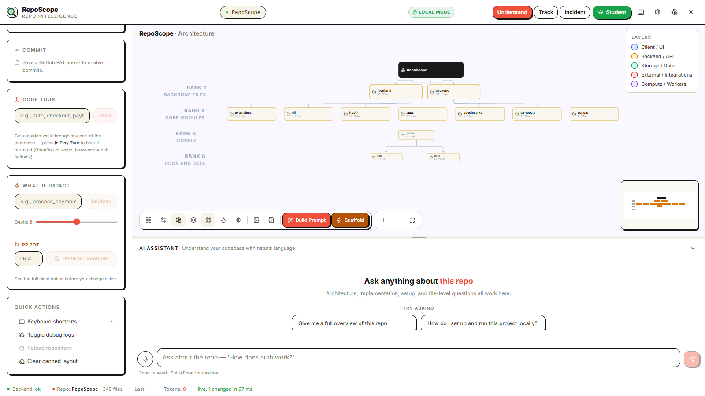

#### **PR Bot**

Preview the comment and risk summary before anything is posted.


#### **BYOK**

Keep GitHub and provider keys in the browser tab, not on disk.

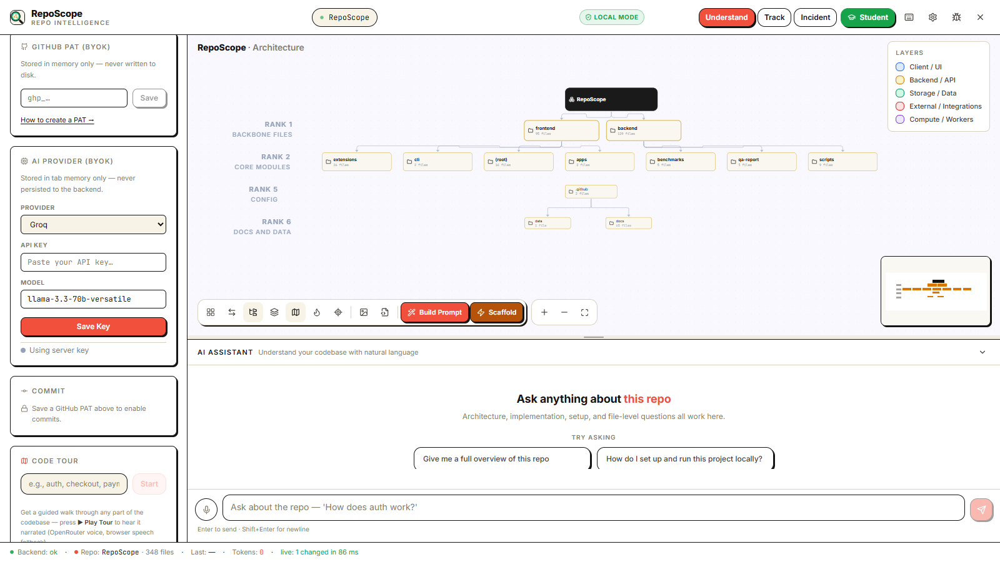

#### **Tracking and Security**

Two modes of the same repository panel.

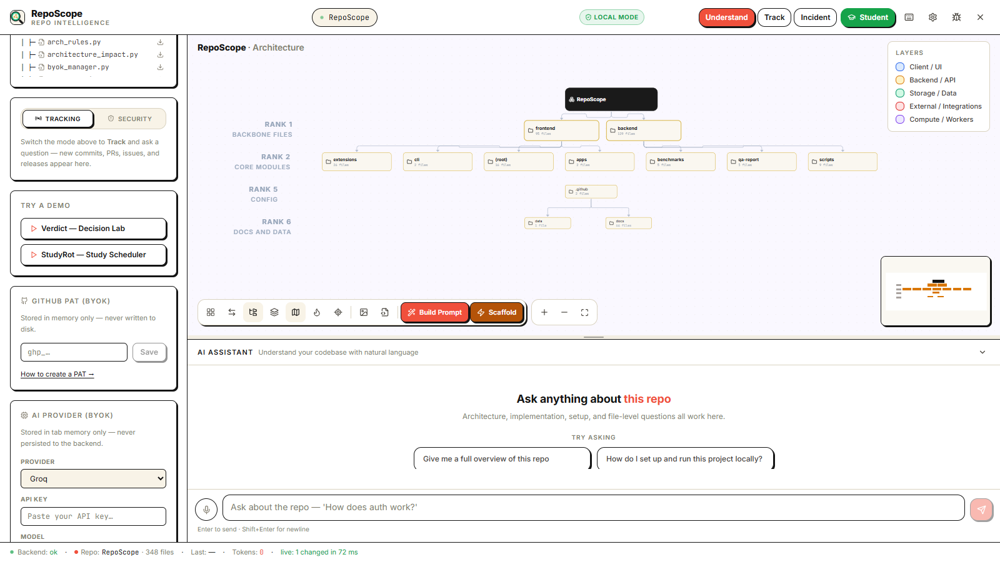

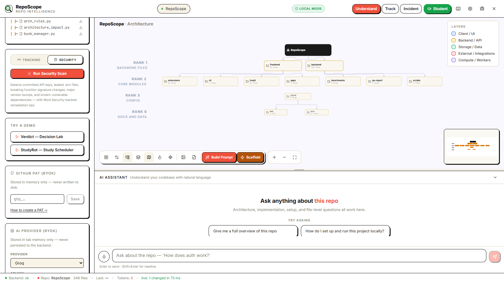

#### **Student Mode**

Turns the graph into a three-level onboarding path.

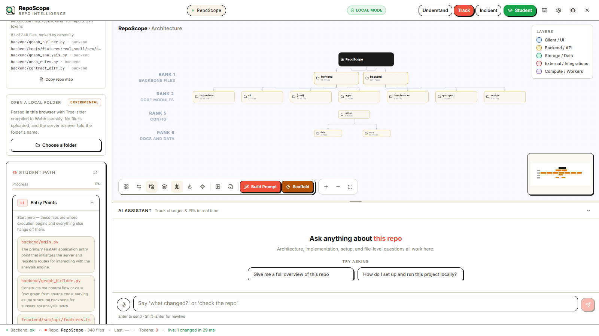

#### **Demo repositories**

Load a public repository through the normal GitHub path.

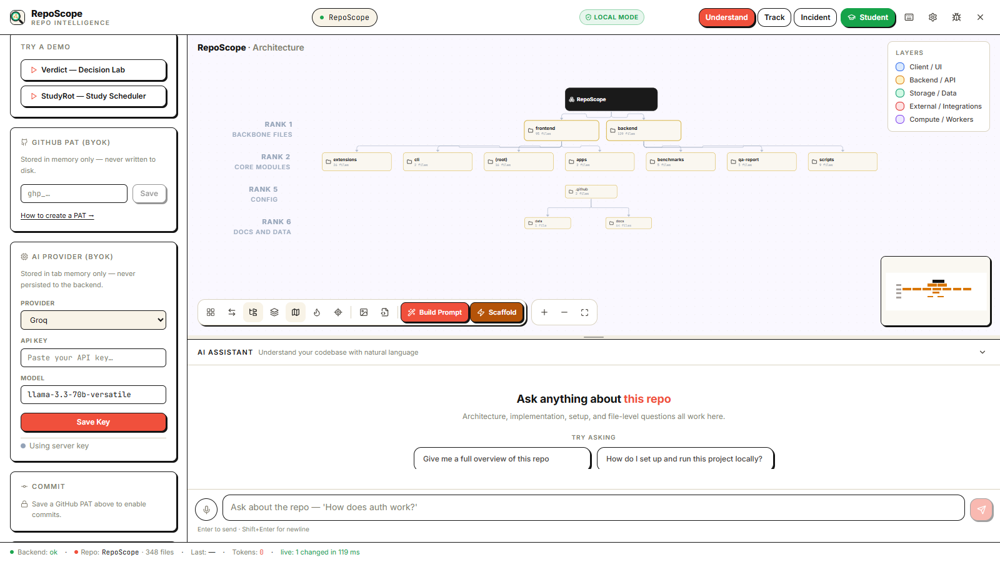

### Chat with citations

The current assistant still streams answers with file, function, and line
citations plus a **Next steps** section. This capture is from the earlier UI
generation, so the surrounding chrome is older, but it is the available chat
panel shot.

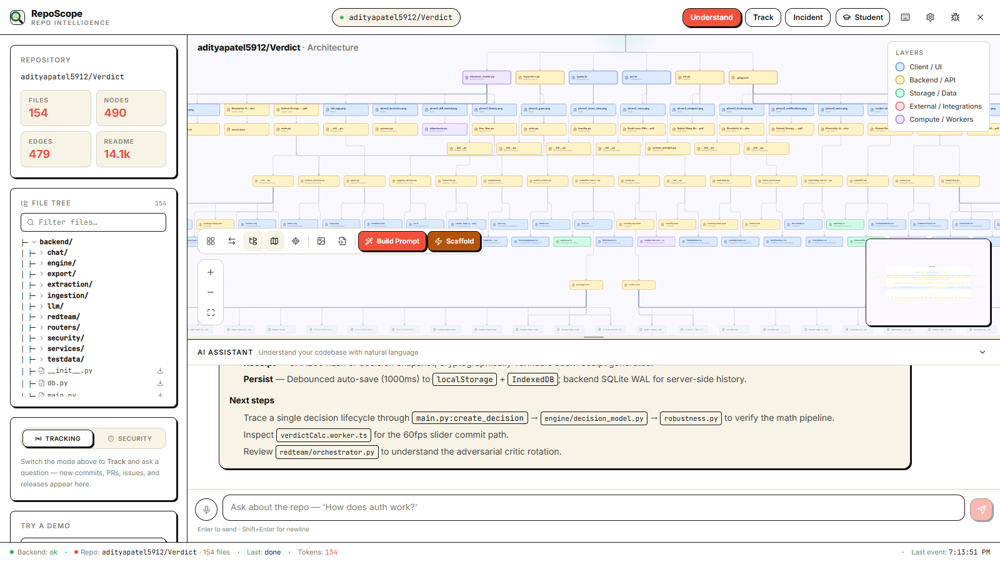

### MCP in OpenCode

The RepoScope MCP server is connected as a local server in OpenCode. The same
8 tools and 5 resources are available to any MCP client.

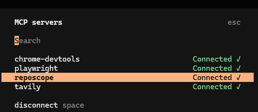

The status list confirms the connection:

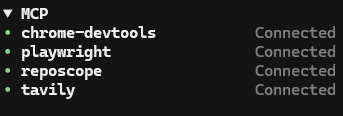

### Local folder preview

**Open a local folder** parses a folder in the browser with Tree-sitter
WebAssembly. The panel labels the result as a browser preview, because this
graph has no cross-file symbol resolution and the server never sees it.


---

## Quick start

### 1. Local mode (recommended)

```bash
git clone https://github.com/adityapatel5912/RepoScope.git
cd RepoScope
pip install -e .

cd /path/to/your/repo
reposcope run .
```

Open <http://127.0.0.1:4100>. The CLI prints the file count, the graph counts,
and whether the watcher is on. Edit a file and the graph updates without a
reload. Nothing is uploaded.

> Install from this checkout. The `reposcope` name on PyPI currently resolves
> to an unrelated older package, so `pip install reposcope` is not the
> supported path for this codebase.

Other commands:

```bash
reposcope index .                 # write the index, do not start a server
reposcope index . --format sqlite # alternate store format
reposcope mcp .                   # serve the index over MCP (stdio)
```

From a checkout, the same commands run as modules:

```bash
python -m cli.main run . --port 4100 --no-open
python -m mcp_server.server --root .
```

### 2. Full stack (GitHub loading, chat, PR bot)

```bash
git clone https://github.com/adityapatel5912/RepoScope.git
cd RepoScope
cp .env.example .env
# Add at least one LLM key to .env.

pip install -e ".[dev]"

# Terminal 1
cd backend
uvicorn main:app --reload --port 8000

# Terminal 2
cd frontend
npm install
npm run dev
```

Open <http://localhost:5173>. The full stack adds GitHub loading, cited chat,
impact analysis, code tours, tracking, Student Mode, security scans, scaffolds,
and the PR Bot. Those features need LLM keys; the graph and local mode do not.

### 3. MCP server

```bash
# From a checkout, with the backend package installed:
python -m mcp_server.server --root /absolute/path/to/repo

# Or, after `pip install reposcope`:
reposcope-mcp --root /absolute/path/to/repo

# Streamable HTTP instead of stdio:
reposcope-mcp --root /absolute/path/to/repo --http --port 8765
```

Example client configuration:

```json
{
  "mcpServers": {
    "reposcope": {
      "command": "reposcope-mcp",
      "args": ["--root", "/absolute/path/to/repo"]
    }
  }
}
```

For OpenCode, the same server can be run from the checkout. The working
configuration is committed at [`opencode.json`](opencode.json); a portable
copy is in [`docs/opencode-mcp.json`](docs/opencode-mcp.json):

```json
{
  "mcp": {
    "servers": {
      "reposcope": {
        "type": "local",
        "command": ["python", "-m", "mcp_server.server", "--root", "/absolute/path/to/repo"],
        "cwd": "backend"
      }
    }
  }
}
```

The connection is verified: `opencode mcp list` reports
`✓ reposcope connected`, and the client panel is shown in
[Screenshots → MCP in OpenCode](#mcp-in-opencode).

The server speaks **stdio** and **Streamable HTTP**. SSE is not offered.

**Tools:** `get_architecture_overview`, `calculate_blast_radius`,
`get_dependency_lineage`, `explain_architectural_rule`, `get_repo_map`,
`find_dependency_cycles`, `get_hotspots`, `find_unreachable_symbols`.

**Resources:** `reposcope://graph/summary`, `reposcope://hotspots`,
`reposcope://repo-map`, `reposcope://dead-code`, `reposcope://cycles`.

### 4. VS Code / Cursor / VSCodium

Install the VSIX from the release or build it locally:

```bash
code --install-extension extensions/vscode/reposcope-2.0.1.vsix
# or: cursor --install-extension extensions/vscode/reposcope-2.0.1.vsix
```

The extension adds:

- the **RepoScope** Activity Bar view, a focus-first mini-graph centred on the
  open file;
- a status-bar blast-radius indicator;
- a **View Callers** CodeLens above exported symbols;
- **RepoScope: Focus this node in the canvas** in the Explorer context menu;
- the `reposcope://open` URI handler.

The extension never parses code. It reads the RepoScope backend over HTTP. The
default is `http://127.0.0.1:8000` (the full-stack API); for local mode
(`reposcope run .`), set `reposcope.backendUrl` to
`http://127.0.0.1:4100`.

The extension is version **2.0.1**. It is published to Open VSX. The listing
is reachable by direct URL and the search API, but the publisher namespace is
still unverified, so the verified badge and stable search placement are not
guaranteed. The VS Code Marketplace still needs an Azure DevOps PAT. See
[`extensions/vscode/README.md`](extensions/vscode/README.md).

---

## What the graph contains

RepoScope parses Python, TypeScript, TSX, JavaScript, Go, and Rust with
Tree-sitter. It builds:

- **file nodes** for every indexed file;
- **symbol nodes** for functions, methods, and classes;
- **`imports` edges** resolved against a module index, including relative and
  alias imports;
- **`calls` edges** resolved across files where the parser can see the target;
- **`contains` edges** between a file and its symbols.

On top of the graph:

- **PageRank centrality** ranks files;
- **dependency cycles** are detected with strongly connected components;
- **unreachable symbols** are a static reachability estimate;
- **git churn** feeds the hotspot overlay;
- **architecture rules** live in `.reposcope.yml` and are checked per import;
- **blast radius** is a reverse BFS over the dependency graph.

The canvas groups a large repository by top-level module, keeps the rank rows
compact, and gives every file a row in the drawer. A small repository still
uses the full connectivity pyramid.

---

## Measured context savings

An agent that reads the whole repository pays for the whole repository.
RepoScope's repo map is ranked by the same PageRank score and stops at a token
budget.

The numbers below are from `benchmarks/run.py` over 14 repositories (4 local
fixtures and 10 public ones). The raw output is committed under
`benchmarks/results/`.

| Repository | Files | Nodes | Full context | RepoScope map | Reduction |
|---|---:|---:|---:|---:|---:|
| `psf/black` | 544 | 3,753 | 2,006,931 | 7,926 | **99.6%** |
| `Textualize/rich` | 582 | 2,649 | 2,971,154 | 7,920 | **99.7%** |
| `psf/requests` | 159 | 937 | 2,632,160 | 3,989 | **99.8%** |
| `pallets/click` | 207 | 2,256 | 537,806 | 7,840 | **98.5%** |
| `encode/httpx` | 154 | 1,365 | 348,904 | 5,192 | **98.5%** |

Reproduce them:

```bash
python benchmarks/run.py
```

On this repository the repo-map endpoint is now roughly **2–5 seconds** after
the index is warm, down from 14–24 seconds before the walk was pruned.

---

## Architecture at a glance

```
Local folder ──► CLI / watcher ──┐
                                 ├─► Tree-sitter parsers ──► graph builder
GitHub repo ──► repo loader ─────┘                              │
                                                                ▼
                                                     .reposcope/graph.json
                                                                │
              ┌─────────────────────────────────────────────────┼──────────────────┐
              ▼                                                 ▼                  ▼
       FastAPI + SSE                                      MCP server         VS Code extension
              │                                                 │                  │
              ▼                                                 ▼                  ▼
       React canvas                                     Claude / Cursor /     Activity Bar
       chat, impact, tours,                             OpenCode / agents     mini-graph
       PR bot, Student Mode
```

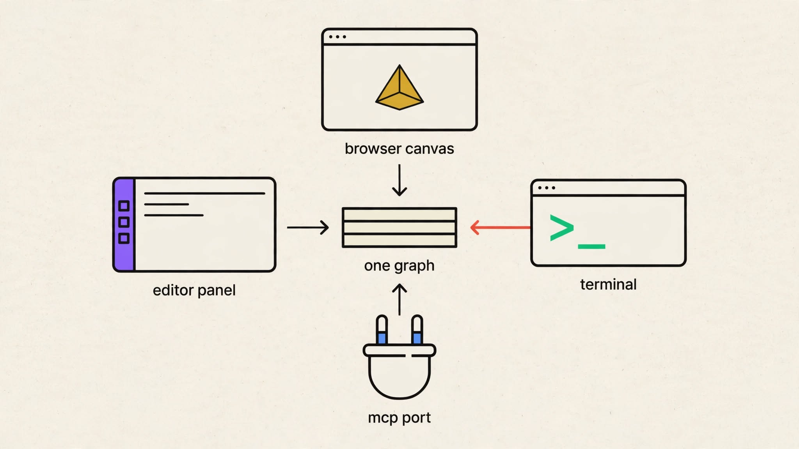

*The same index serves every surface; no surface has its own copy of the
graph.*

- **Backend:** Python 3.11, FastAPI, Tree-sitter, NetworkX, GitPython.
- **Frontend:** React 18, Vite, TypeScript (strict), React Flow, Tailwind.
- **Storage:** `.reposcope/graph.json` and `.reposcope/parse-cache.json`.
- **LLM chain (optional):** OpenRouter → Groq → NVIDIA NIM, multi-key rotation.
- **MCP:** the official Python SDK, stdio and Streamable HTTP.
- **Extension:** TypeScript, VS Code WebviewViewProvider, CodeLens, status bar.

See [`docs/ARCHITECTURE.md`](docs/ARCHITECTURE.md) for the full reference.

---

## Configuration

| Variable | Required | Purpose |
|---|---|---|
| `OPENROUTER_API_KEYS` | Yes* | Primary LLM; comma-separate for rotation |
| `GROQ_API_KEYS` | Yes* | Secondary LLM; comma-separate |
| `NVIDIA_API_KEYS` | Fallback | Tertiary LLM; comma-separate |
| `Models_OPENROUTER` / `Models_GROQ` / `Models_NVIDIA` | No | Model overrides |
| `Base_URL_OPENROUTER` / `Base_URL_GROQ` / `Base_URL_NVIDIA` | No | OpenAI-compatible endpoints |
| `GITHUB_TOKENS` | Optional | Raises GitHub API limits; comma-separate |
| `OVSX_TOKEN` | Publish only | Open VSX publisher token; keep it in the gitignored `.env` |

\* At least one provider needs a key for the LLM-backed features. The graph,
local mode, CLI, and MCP server run without any key.

Legacy single-key variables (`OPENROUTER_API_KEY`, `GROQ_API_KEY`,
`NVIDIA_API_KEY`, `GITHUB_PAT`) are still accepted. See
[`.env.example`](.env.example).

---

## Verification status

Verified in this session:

- `cd backend && python -m pytest -q` → **335 passed**;
- `cd frontend && npx tsc --noEmit` → clean;
- `cd frontend && npm run build` → **built successfully**
  (`assets/index-CMSb0cnC.js`);
- `/api/health` → 200, version **2.0.0**, matching `pyproject.toml`;
- local mode → **348 files, 1,863 nodes, 3,419 edges**; watcher on;
- native folder picker → **75 files, 315 nodes, 310 edges**; Python,
  JavaScript, TypeScript; no folder upload observed;
- VS Code extension **2.0.1** in VS Code 1.143.0 → Activity map, status bar,
  CodeLens, Explorer menu, `reposcope://open`, offline/recovery;
- real MCP stdio sweep → **8 tools, 5 resources, 3 read rounds, clean ping**;
- OpenCode MCP status → `✓ reposcope connected`.

The remaining manual checks are:

- Cursor/VSCodium extension testing;
- Open VSX namespace verification and the verified badge;
- redeploying Render so `/api/health` reports **2.0.0** there too;
- VS Code Marketplace publishing (Azure DevOps PAT).

The living checklist is
[`docs/VERIFICATION_CHECKLIST.md`](docs/VERIFICATION_CHECKLIST.md). It is
deliberately separate from the docs so it can stay unchecked until a human
confirms each item. Agent-run evidence is recorded separately in
[`docs/QA_REPORT.md`](docs/QA_REPORT.md#agent-run-evidence--2026-10-25).

---

## Known limitations

- **The native folder picker is outside Playwright.** The browser path uses
  `window.showDirectoryPicker`; the final pass drove the OS dialog with Win32
  automation.
- **The browser preview is lighter than the server.** It has imports and
  symbols, but no cross-file symbol resolution. The UI says so, and it hides
  server-backed chat, tracking, Student Mode, and analysis panels while the
  preview is active.
- **Some MCP clients have resource-read bridge issues.** The RepoScope server
  answers `reposcope://graph/summary` in 0.0s over stdio; one OpenCode bridge
  stalled for several minutes and then reported an unknown message ID. Tool
  calls continued to work. This is a client-side bridge limitation.
- **The Open VSX namespace is unverified.** Version 2.0.1 is published,
  installable, and returned by search, but the namespace is `verified:false`,
  so the verified badge and stable search placement are not guaranteed.
- **The VS Code Marketplace needs an Azure DevOps PAT.** It is not published
  there yet.
- **Render still reports version `1.0.0`.** The health fix is local and must
  not be deployed without approval.
- **Test fixtures are indexed as production code.** A "tests are not
  architecture" mode is still open.
- **The WebGL tier, the `kuzu` flag, monorepo cross-package edges, the
  ownership overlay, the critical-path panel, and the visual-regression
  baselines are still open.** These are carried in the roadmap.
- **LLM-backed features need provider keys.** Without a key, the graph and
  local mode work; chat, tours, Student Mode, security narrative, and PR Bot
  do not.

---

## Documentation

| Document | What it covers |
|---|---|
| [Documentation index](docs/README.md) | Which docs are current, reference, or historical |
| [v2.0 pitch deck](RepoScope_v2_Pitch_Deck.pdf) | 14-slide product story; [editable PPTX](RepoScope_v2_Pitch_Deck.pptx) |
| [Architecture](docs/ARCHITECTURE.md) | Modules, data flow, endpoints, graph layout, MCP |
| [API](docs/API.md) | Graph schema v2, health payload, mind-map contract |
| [Features](docs/FEATURES.md) | Every feature, how to use it, and its limits |
| [Development](docs/DEVELOPMENT.md) | Setup, tests, extension, QA |
| [Deployment](docs/DEPLOYMENT.md) | Render + Vercel + Open VSX |
| [Troubleshooting](docs/TROUBLESHOOTING.md) | Failures we have actually seen |
| [QA report](docs/QA_REPORT.md) | What is verified and what is not |
| [v2.0 roadmap](docs/ROADMAP_V2.md) | The plan, the delivered sprints, the honest gaps |
| [Verification checklist](docs/VERIFICATION_CHECKLIST.md) | The four manual checks still pending |
| [Screenshots](docs/SCREENSHOTS.md) | Screenshot index and capture notes |
| [Knowledge graph schema](docs/KNOWLEDGE_GRAPH_SCHEMA.md) | Node and edge ids |
| [OpenCode MCP config](docs/opencode-mcp.json) | Portable local-server config verified in OpenCode |
| [Contributing](CONTRIBUTING.md) | Setup and commit conventions |
| [Code of Conduct](CODE_OF_CONDUCT.md) | Community standards |

[Demo script](docs/DEMO.md) — a current 3-minute walkthrough.

---

## Brand assets

The existing logo and brand kit are unchanged. The generated hero, social
card, and one-index diagram use the same cream/ink/coral palette.

- [Brand kit and logo](frontend/public/brand/brand-kit.html)
- [Social card](frontend/public/brand/og-image.png) — 2192×1152
- [README hero](docs/assets/readme-hero.png) — 2048×1152
- [One-index diagram](docs/assets/one-index-diagram.png) — 2048×1152

---

## Tech stack

| Layer | Technology |
|---|---|
| Frontend | React 18, Vite 6, TypeScript (strict), React Flow, Tailwind |
| Backend | Python 3.11, FastAPI, SSE, httpx, GitPython, NetworkX |
| Parsing | Tree-sitter: Python, TypeScript, TSX, JavaScript, Go, Rust |
| Graph | PageRank, SCC cycles, reverse-BFS blast radius, git churn |
| LLM | OpenRouter → Groq → NVIDIA NIM, multi-key rotation, BYOK |
| MCP | Python MCP SDK, stdio + Streamable HTTP |
| Extension | VS Code API, WebviewViewProvider, CodeLens, status bar |
| Deployment | Render (API), Vercel (frontend), Open VSX (extension) |

---

## License

RepoScope is **source-available**, not OSI Open Source. You may read, run,
modify, and use it in your own projects, including internal business projects.
You may not republish, distribute, sublicense, sell, or otherwise commercially
exploit RepoScope or a modified version without prior written permission from
the copyright holder. See [LICENSE](LICENSE) for the complete terms; the same
terms apply to the extension's [LICENSE](extensions/vscode/LICENSE).

Earlier releases were published under MIT, and those grants cannot be revoked.
That includes the currently published Open VSX extension **2.0.1** and the
existing `reposcope-2.0.1.vsix`, which predate this license change. The source
tree and future builds use the source-available license; bump the extension
version before publishing the new terms.

## Acknowledgments

Graph aesthetic inspired by GitDiagram; reverse-prompt idea inspired by
GitReverse; repository-tree format inspired by Gitingest.
