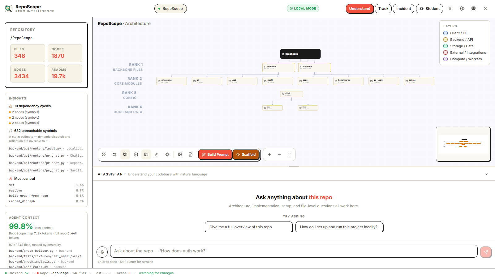
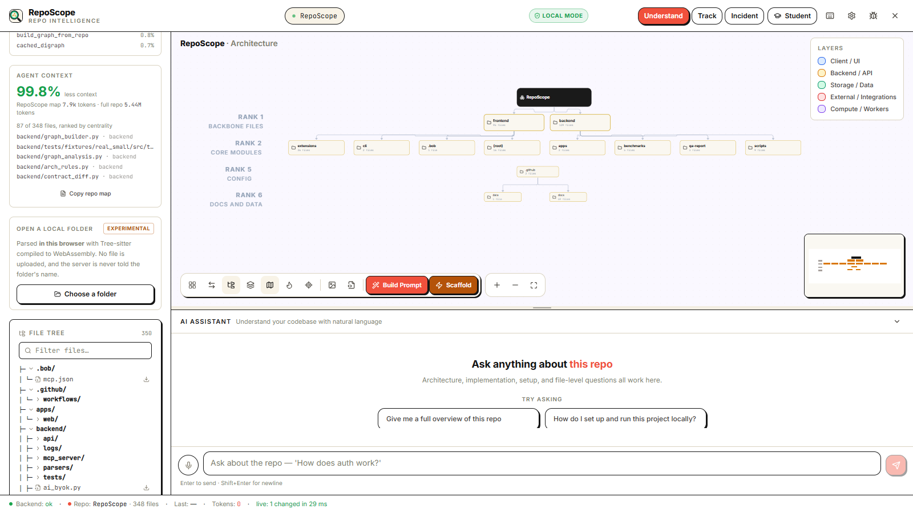

# RepoScope — features

This is the current feature set (package **2.0.0**, extension **2.0.1**).
Every feature below is either implemented and verified, implemented with a
stated limit, or explicitly marked as planned. The four remaining manual
checks live in [`VERIFICATION_CHECKLIST.md`](VERIFICATION_CHECKLIST.md).

---

## 1. The code graph

**What it is:** one Tree-sitter index of a repository, stored as
`.reposcope/graph.json`.

- File nodes for every indexed file.
- Function, method, and class nodes.
- `imports` edges resolved through a module index, including relative and
  aliased imports.
- `calls` edges resolved across files where the parser can see the target.
- `contains` edges from a file to its symbols.
- **Schema v2 edges:** `inherits` from a class to a resolvable base class,
  `exports` from a barrel file to what it re-exports, and `api_calls` from a
  frontend caller to the backend route handler it calls. Each v2 edge carries
  evidence: repository-relative file, 1-based line, and confidence.
- **Schema v2 node evidence:** files and symbols carry `path`, `pillar`,
  `role`, and `route_count`; handlers carry their `routes`; symbols carry
  `end_line`. v1 node ids and edge meanings are unchanged.
- **Declared routes:** Python route decorators and Express-style routes are
  recorded in the graph-level `api_routes` table and on the handler nodes.
- PageRank centrality, dependency cycles, reachability, hubs, critical path,
  and git-churn hotspots.
- Architecture rules loaded from `.reposcope.yml`.

The persisted graph is `schema_version: 2`. A v1 graph still loads. The
builder is deterministic and conservative: if a target is ambiguous, the edge
is omitted rather than guessed.

**Languages:** Python, TypeScript, TSX, JavaScript, Go, Rust. Other files are
indexed as file nodes without symbol extraction.

**Limit:** call resolution is static. Dynamic dispatch, reflection, and
generated code can be missed. This is stated rather than hidden.

---

## 2. Architecture canvas



- **Small repositories:** a connectivity pyramid. The repository is the root;
  ranks descend through backbone files, core modules, routers/services, UI,
  config, and docs/data.
- **Large repositories:** top-level modules become cluster cards when the file
  count crosses the grouping threshold. The cards show file counts; every file
  remains reachable in the drawer. The RepoScope repository itself resolves to
  a set of top-level module cards; the count is shown in the UI at load time.
- **Module drawer:** click a cluster to see its files, edges, and actions.
- **Node details:** select a file for its symbols, importers, dependencies, and
  actions.
- **Canvas controls:** zoom, fit view, export PNG, export SVG.
- **Rank labels:** visible on the canvas.
- **Edit:** double-click or use the drawer action to open a file in the editor
  integration.

**Mind-map projection (V2.5):** the backend exposes a frozen
`GET /api/mindmap?include_symbols=true&max_nodes=20000` contract. It projects
the same graph into `root → pillar → folder → file → symbol`, with six
server-classified pillars and deterministic ordering. The vertical Mind Map
view beside the dependency canvas is Phase 2 work; at this snapshot the
endpoint and payload are frozen, and the dependency canvas remains the default
view. The full payload is documented in [API.md](API.md#get-apimindmap).

**Limits:** the grouped view is a rendering collapse, not a second graph. The
full graph is still returned by the API. Very large repositories beyond the
tested range may need the WebGL tier, which is still planned.

---

## 3. Local mode



```bash
reposcope run .
```

- Parses the current folder; no GitHub account, token, or clone.
- Serves the canvas on `http://127.0.0.1:4100`.
- Watches for edits and re-indexes changed files.
- Streams re-index events to the browser over `/api/local/events`; no page
  reload.
- Resumes a local session after a server restart.
- Prints file, node, and edge counts plus the watcher state.
- `--no-open` suppresses the browser launch.

**Privacy:** nothing from the repository is uploaded. The local router has no
outbound GitHub code path.

**Limit:** the watcher is best-effort; ignored directories and generated files
are not tracked. Use `reposcope index .` to rebuild deliberately.

---

## 4. CLI

| Command | Purpose |
|---|---|
| `reposcope run .` | Index, serve, and watch a local folder |
| `reposcope index .` | Write `.reposcope/graph.json` without a server |
| `reposcope index . --format sqlite` | Write the alternate store format |
| `reposcope mcp .` | Serve the graph over MCP (stdio) |

From a checkout, the same commands run as `python -m cli.main ...`.

---

## 5. MCP server

The same index, exposed to agents.

**Tools (13):**

- `get_symbol_impact`: Traces direct and transitive dependent callers of a symbol.
- `get_file_impact`: Measures downstream dependents of a modified file.
- `get_architecture_overview`: High-level summary of layers, entry points, and coupling.
- `find_circular_dependencies`: Detects cycles within and across architectural layers.
- `find_unreachable_symbols`: Flags statically unreferenced symbols for dead-code investigation.
- `explain_architecture_rules`: Explains layer hierarchy and identifies rule violations.
- `get_active_tour`: Returns steps and narrative for guided repository tours.
- `calculate_churn_metrics`: Analyzes git commit hotspots and co-change coupling.
- `get_mindmap_hierarchy`: Returns the hierarchical semantic tree (pillar to symbol).
- `get_ast_skeleton`: Extracts symbol signatures and line numbers without bodies.
- `get_context_pack`: Builds deterministic, budgeted context packs with delta hash sync.
- `diff_interface_contracts`: Detects export and API contract breaking changes across git refs.
- `get_ranked_reading_path`: Produces prioritized reading paths for codebase onboarding.

**Resources (8):**

- `reposcope://repo-map`: Full file and symbol registry.
- `reposcope://arch-rules`: Defined architectural rules and violation evidence.
- `reposcope://active-tour`: Current guided tour steps.
- `reposcope://churn-report`: High-frequency commit churn analysis.
- `reposcope://dead-code`: Unreferenced symbol candidates for review.
- `reposcope://mindmap`: Semantic hierarchy tree.
- `reposcope://api-routes`: Declared HTTP route handlers and methods.
- `reposcope://context-pack`: Default budgeted context pack.

**Transports:** stdio (default) and Streamable HTTP. SSE is not offered.

**Limit:** one OpenCode bridge build has shown a resource-read stall (several
minutes, then `Received a response for an unknown message ID`). Direct stdio
reads are instant and the tool calls work. Treat this as a client bridge issue
until reproduced against the server.

### Nine-agent harness configurator (Phase 3)

The **Connect AI agent** control generates MCP configuration for Claude Code,
Cursor, VS Code / Copilot, Codex CLI, Kiro, Antigravity, Windsurf / Devin,
Cline / Roo, and OpenCode.

- **Preview first:** choose an agent and transport; RepoScope shows the exact
  file contents, the install command, and a unified diff for any file that
  already exists.
- **Two transports:** stdio is the default; Streamable HTTP points at
  `http://127.0.0.1:8765/mcp`. Every target supports both.
- **Safe writes:** writes are off unless the server runs with
  `REPOSCOPE_HARNESS_APPLY=1`. Preview never writes. An existing file that
  would change needs an explicit `force` confirmation.
- **Project-only:** every path is relative to the loaded repository. Global
  agent paths are displayed for reference and are never written. Path
  traversal, absolute paths, and symlink/junction escapes are rejected.
- **Merge, not replace:** unrelated JSON/TOML keys survive; markdown
  instruction files get one delimited RepoScope section.
- **Skills:** five specialized agent skills are shipped (`blast-radius-guard`,
  `zero-grep-architect`, `pr-contract-shield`, `onboarding-navigator`,
  `dead-code-surgeon`), written to `.claude/skills/*` and `.agents/skills/*`.

The frozen HTTP contract is in
[API.md](API.md#harness-configurator-phase-3). Setup instructions for all nine
targets are in [AGENT_INTEGRATION.md](AGENT_INTEGRATION.md).

**Limit:** Phase 3 writes configuration only. It does not install any agent,
start a server, or verify a target that is not installed on the machine.

---

## 6. VS Code / Cursor / VSCodium extension

The extension reads the backend over HTTP; it never parses code.

- **Activity Bar view:** a focus-first mini-graph for the open file.
- **Status bar:** blast radius and risk for the current file.
- **View Callers CodeLens:** caller count above exported symbols; asks before
  enabling.
- **Explorer context menu:** **RepoScope: Focus this node in the canvas**.
- **URI handler:** `reposcope://open?path=...&line=...`.
- **Offline state:** says **RepoScope: offline** instead of showing zero.

Settings: `reposcope.backendUrl` (default `http://127.0.0.1:8000`),
`reposcope.canvasUrl` (default `http://127.0.0.1:4100`),
`reposcope.statusBar`, `reposcope.codeLens`. For local mode, point
`reposcope.backendUrl` at `http://127.0.0.1:4100`.

**Distribution:** VSIX is built locally; version 2.0.1 is published to Open
VSX. The listing is searchable, but the publisher namespace is still
`verified:false`, so the verified badge and stable ranking are not guaranteed.
The VS Code Marketplace still needs an Azure DevOps PAT.

**Verified in VS Code 1.143.0:** Activity map **348 files, 1,863 nodes, 3,419
edges**; status bar `RepoScope: 12 dependents | Risk: Critical` on
`backend/graph_store.py`; CodeLens `View Callers (6)` for `graph_summary`;
Explorer menu label above; `reposcope://open` opened `backend/main.py` at line
392; wrong port showed **offline** and recovery worked after reload.

**Limit:** the extension cannot be driven by Playwright; the final pass used
Windows UI automation. Cursor/VSCodium remain untested.

---

## 7. Browser preview: open a local folder

The left panel's **Open a local folder** action uses
`window.showDirectoryPicker` and Tree-sitter WebAssembly.

- Imports and symbols are extracted in the browser.
- The folder never reaches the backend.
- The UI labels the result a **browser preview**.
- It has no cross-file symbol resolution, so it is lighter than the server
  graph.
- Chat, Track/Incident, Student Mode, Insights, Repo Map, Security, Commit,
  Tour, and Impact are hidden while a preview is active; those surfaces read
  the server's loaded repository and would describe a different codebase.
- Cancelling the picker keeps the previous preview. A denied picker explains
  that folder access was not granted, and an empty/unsupported folder explains
  why no graph could be built.

**Limit:** Chrome or Edge on `localhost`/HTTPS is required; Firefox does not
implement the API. The OS dialog itself is outside Playwright, although the
final pass drove it with Win32 automation.

---

## 8. Chat with citations

- SSE-streamed answers.
- Context assembled from the graph and cited files.
- File, function, and line citations.
- Markdown, tables, and code blocks with copy buttons.
- Model/provider chain: OpenRouter → Groq → NVIDIA NIM.
- Multi-key rotation on 429s.
- BYOK GitHub token for private repositories (memory-only).
- Voice input where the browser supports it.

**Limit:** requires a provider key. The graph and local mode do not.

---

## 9. Impact analysis and PR Bot

- Blast radius: direct and transitive dependents.
- Risk score, narrative, and suggested tests.
- On-canvas highlighting of affected files.
- GitHub-ready PR comment with a Mermaid impact graph.
- Included GitHub Action posts the comment on pull requests.

**Limit:** the live comment path needs a real PR and a token with
`pull-requests: write`. Test on a repository you own.

---

## 10. Code tours and voice

- Guided walkthroughs of a module.
- Numbered stops on the canvas.
- Camera pans and highlights each step.
- Optional voice narration through OpenRouter TTS, with browser speech as a
  fallback.

**Limit:** requires an LLM/TTS provider for generated tours; the browser
fallback is lower quality.

---

## 11. Tracking

- Commits, pull requests, issues, and releases.
- On-demand GitHub polling.
- Grouped by change type.
- Breaking-change flags.
- State persisted in `data/repo_state.json`.

**Limit:** GitHub API rate limits apply; a token raises them.

---

## 12. Student Mode

- Three-level path: entry points → core modules → utilities.
- Per-file “why it matters” notes.
- Checkpoint quizzes.
- Good First Issue suggestions mined from low-traffic files.

**Limit:** generated content needs an LLM. The ranking itself comes from the
graph.

---

## 13. Security scan

- Committed secrets, redacted in output.
- Leaked `.env` files.
- Breaking signature changes.
- Vulnerable dependency pins.
- Taint analysis endpoint.
- Remediation guidance.

**Limit:** heuristic detection, not a replacement for a dedicated scanner. It
does not execute untrusted code.

---

## 14. Reverse build prompt and scaffold

- **Reverse prompt:** turn a repository into a “Build me a…” Markdown prompt.
- **Scaffold:** Stage 1/2/3 starter with boilerplate and TODOs.
- **Download:** ZIP.
- **Open:** StackBlitz.
- Never downloads the full codebase.

**Limit:** generated scaffold quality depends on the provider; review it
before use.

---

## 15. File tree and exports

- GitIngest-style tree.
- Search filter.
- Single-file download.
- PNG and SVG graph export.
- Repository tree generation.

---

## 16. Health and configuration

- `GET /api/health`: uptime, memory, provider key counts, version, graph
  `schema_version`, and cached node/edge counts without building a graph.
- The version is **2.0.0**, matching `pyproject.toml`; a regression test fails
  if the two drift.
- Provider/model/base URL configuration through `.env`.
- Legacy single-key variables accepted.
- No key material is returned by the API.

---

## 17. Known gaps

These are intentionally not presented as shipped:

- WebGL rendering tier for very large graphs.
- The `kuzu` graph-store flag.
- Monorepo cross-package edges.
- Ownership overlay (the endpoint exists; the data is not populated).
- Critical-path panel in the UI (analysis endpoint exists).
- Visual-regression baselines.
- An unbounded 50k-file measurement.
- Excluding test fixtures from “architecture” by default.
- VS Code Marketplace publishing (blocked on an Azure DevOps PAT).
- Open VSX namespace verification (the listing is searchable without it).
- Render redeployment of the health-version fix.

The roadmap tracks the feature gaps. The verification checklist tracks the
manual work.

---

## 18. License

RepoScope is **source-available**, not OSI Open Source. The
[RepoScope Source-Available License 1.0](../LICENSE) lets you run, modify, and
use it in your own projects, including internal business projects. It does not
let you republish, distribute, sublicense, sell, or otherwise commercially
exploit RepoScope or a modified version without prior written permission. The
extension carries the same terms in
[`extensions/vscode/LICENSE`](../extensions/vscode/LICENSE).
