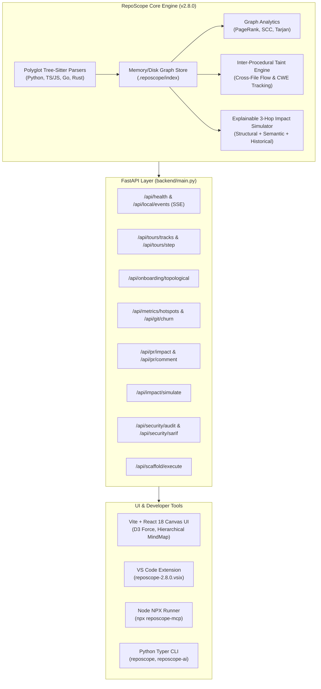

# RepoScope V2.7 & V2.8 Comprehensive Architectural Walkthrough

## Executive Summary

RepoScope is an autonomous code intelligence and architecture platform providing code graph visualizers, explainable blast-radius analysis, inter-procedural security audits, and agentic integrations over a single shared index.

This document serves as the master walkthrough for **RepoScope Release v2.8.0** (spanning all milestones across **V2.7 and V2.8**, Phases 5 through 14A), detailing every system component, API contract, mathematical formula, CLI invocation, and verification artifact.

---

## Architecture at a Glance



---

## Milestone Breakdown & Implementation Details

### Phase 5 & 6: MindMap V2, Tree Navigation & Reverse Prompt Compiler

- **MindMap V2 Hierarchical Layout**:
  - Implemented dynamic D3 hierarchy with collapsible tree navigation (`frontend/src/components/MindmapView.tsx`).
  - Added horizontal Left-to-Right (`LR`) and vertical Top-to-Bottom (`TB`) orientations with auto-centering on active root nodes.
  - Zero-lag SVG rendering with custom directory-level clustering.
- **Reverse Prompt Compiler (`backend/reverse_prompt_compiler.py`)**:
  - Compiles raw repository graph subgraphs into 4 distinct LLM prompting modalities:
    1. `context`: Dense topological context with structural dependency hierarchy and file summaries.
    2. `rebuild`: Green-field reproduction prompt specifying interfaces, protocols, and architectural invariants.
    3. `spec`: Formal API contracts and data models suitable for test-driven development.
    4. `feature`: Targeted context for implementing a feature ticket without hallucinating dependencies.
  - Interactive UI modal with mode switching, token estimator, and one-click copy.

---

### Phase 7: Interactive Architecture Scaffolder (`backend/scaffolder.py`)

- **Capability**: Enables users and agents to scaffold clean architectural templates (Clean Architecture, Ports & Adapters, Modular Monolith, Microservice Core) based on existing repository conventions.
- **Components**:
  - `backend/scaffolder.py`: Generates deterministic folder trees, typed boilerplate, `README.md` documentation, and build manifests.
  - `POST /api/scaffold/execute`: Non-destructive execution endpoint creating skeleton structures safely.
  - `frontend/src/components/ScaffolderModal.tsx`: Visual preview of target structure with syntax-highlighted sample code and CLI copy helper.

---

### Phase 8: Architectural Tours & Universal Chat Action Cards

- **Capability**: Guided, narrative walkthroughs across codebase concepts with deep-link navigation and universal chat action cards.
- **Components**:
  - `backend/tour_generator.py`: Generates directed tour tracks (e.g., "Request Lifecycle", "Data Ingestion Pipeline", "Authentication & Security").
  - `backend/chat_actions.py`: Intent analysis engine that parses chat responses and emits actionable visual cards:
    - `[Launch Architectural Tour]`: Opens Tour player and focuses graph nodes.
    - `[Open Security Audit Dashboard]`: Switches directly to the 6-Engine Security panel.
    - `[Download SARIF Report]`: One-click OASIS SARIF 2.1.0 export.
    - `[Run Impact Simulator]`: Triggers 3-hop blast radius simulation.
  - `frontend/src/components/TourPanel.tsx`: Interactive tour player with audio narration support (Web Speech API / ElevenLabs) and auto-zoom.

---

### Phase 9: Topological Onboarding & Interactive Code Katas

- **Capability**: Converts the code graph into an optimal reading and learning order based on directed acyclic graph (DAG) dependencies.
- **Algorithmic Foundation**:
  - Implements **Kahn's Topological Sorting** on the import dependency graph:
    $$T = \text{TopologicalSort}(G_{\text{imports}})$$
  - Groups files into progressive tiers:
    - **Tier 1 (Foundations)**: Leaves of the dependency tree (models, constants, utility primitives) with zero internal dependencies.
    - **Tier 2 (Core Business Logic)**: Intermediate services consuming Tier 1 primitives.
    - **Tier 3 (Application Boundary)**: Controllers, HTTP routers, and CLI entry points.
  - Generates auto-evaluated quiz challenges and code katas per tier (`backend/onboarding.py`).
  - `frontend/src/components/OnboardingPanel.tsx`: Gamified curriculum dashboard with progress indicators and instant challenge verification.

---

### Phase 10: Hotspots, Bus Factor & Churn Time Machine

- **Capability**: Correlates structural graph metrics with Git commit history to surface architectural risks before they cause outages.
- **Formulas & Metrics (`backend/git_history.py`)**:
  - **Risk Score Formula**:
    $$\text{Risk}(v) = \text{PageRank}(v) \times \ln(1 + \text{Churn}(v)) \times \frac{1}{\text{BusFactor}(v)}$$
    Where:
    - $\text{PageRank}(v)$: NetworkX PageRank centrality representing structural importance.
    - $\text{Churn}(v)$: Total lines added and deleted in the target window (30/60/90 days).
    - $\text{BusFactor}(v)$: Effective author count calculated via Shannon diversity entropy:
      $$\text{BusFactor}(v) = \exp\left(-\sum_{i=1}^{k} p_i \ln p_i\right)$$
      Where $p_i$ is author $i$'s commit share for file $v$.
  - **Time Machine**: Compares git revisions (`backend/git_history.py:compare_refs`) to highlight newly introduced circular dependencies or coupling spikes.
  - `frontend/src/components/MetricsPanel.tsx`: Interactive bubble chart, churn table, and bus factor badges.

---

### Phase 11: Symbol-Level PR Impact & Contract Diff

- **Capability**: Goes beyond file-level git diffs to detect which exact classes, functions, and interfaces changed, tracing caller blast radius across languages.
- **Components**:
  - `backend/contract_diff.py`: Tree-sitter AST symbol extractor comparing `base` and `head` branches to detect:
    - Breaking signature changes (added mandatory parameters, modified types).
    - Removed or renamed symbols.
    - Modified docstrings and contracts.
  - `backend/pr_impact.py`: Computes symbol-level caller chains and produces automated GitHub Markdown PR comments.
  - `frontend/src/components/PRImpactPanel.tsx`: Interactive PR review interface displaying symbol diffs, impact tiers, and one-click GitHub PR comment poster.

---

### Phase 12: Explainable 3-Hop Impact Simulator

- **Capability**: Predicts the cascading blast radius of proposed edits before writing a single line of code.
- **Simulation Engine (`backend/impact_analyzer.py`)**:
  - **Hop 1 (Direct Dependents)**: Direct imports and function callers.
  - **Hop 2 (Transitive Consumers)**: Second-order services and upstream controllers.
  - **Hop 3 (System Boundary & Clients)**: External API endpoints, background workers, and event subscribers.
  - **Risk Weighting**: Combines structural reachability with git co-change frequency:
    $$\text{CoChangeWeight}(u, v) = \frac{\text{Commits}(u \cap v)}{\sqrt{\text{Commits}(u) \cdot \text{Commits}(v)}}$$
  - `frontend/src/components/ImpactSimulatorModal.tsx`: Interactive graph slice showing 3-hop wave propagation, affected test suites, and risk breakdown.

---

### Phase 13: Six-Engine Graph-Contextual Security Suite

- **Capability**: Complete vulnerability auditing engine combining AST analysis, dependency databases, and inter-procedural taint tracking into standard OASIS SARIF 2.1.0 outputs.
- **Engines (`backend/security_scanner.py` & `backend/taint.py`)**:
  1. **Cross-File Taint Engine**: Inter-procedural flow tracking tracking sources (`request.query_params`, `sys.argv`) across module boundaries into dangerous sinks (`cursor.execute`, `eval`, `subprocess.Popen`).
  2. **High-Entropy Secret Hunter**: Detects API keys, private tokens, and passwords with Shannon entropy threshold $H \ge 4.2$, providing strict `<redacted>` masking in memory and API responses.
  3. **Vulnerable Dependency Scanner**: Scans `pyproject.toml`, `requirements.txt`, and `package.json` against an offline CVE database (FastAPI, aiohttp, cryptography, requests, etc.).
  4. **AST Injection Sink Detector**: Tree-sitter powered detection of unparameterized SQL formatting, shell command injections, and path traversal vulnerabilities.
  5. **Insecure Configuration Scanner**: Detects wildcard CORS (`allow_origins=["*"]`), disabled SSL verification (`verify=False`), and production debug flags (`DEBUG=True`).
  6. **Route Auth Bypass Guard**: Detects unauthenticated state-mutating HTTP routes (`POST`, `PUT`, `DELETE`, `PATCH`) lacking authentication dependencies.
- **Remediation & Export**:
  - Non-destructive unified diff patch generator (`generate_security_patch`) with AST syntax validation.
  - Full OASIS SARIF 2.1.0 converter (`backend/sarif.py:flags_to_sarif_json`).
  - `frontend/src/components/SecurityPanel.tsx`: Multi-engine dashboard with severity filters, interactive Taint Propagation Trace, unified diff code viewer, and SARIF export button.

---

### Phase 14A: Global Packaging, Version Source of Truth & VS Code Extension

- **Single Source of Truth**:
  - Centralized release version `2.8.0` defined in `backend/version.py`:
    ```python
    __version__ = "2.8.0"
    VERSION = __version__
    ```
  - Synchronized across:
    - `pyproject.toml` (`version = "2.8.0"`)
    - `frontend/package.json` (`"version": "2.8.0"`)
    - `extensions/vscode/package.json` (`"version": "2.8.0"`)
    - `packages/reposcope-mcp/package.json` (`"version": "2.8.0"`)
    - `backend/main.py` (`/api/health` reports `__version__`)
- **CLI Commands**:
  - `reposcope run [PATH]`: Starts backend and serves live visualizer.
  - `reposcope index [PATH]`: Indexes repo without starting server.
  - `reposcope mcp [PATH]`: Serves repository code graph over Model Context Protocol.
  - `reposcope security [PATH] [--sarif]`: Runs 6-engine security audit directly in terminal with optional SARIF output.
  - `reposcope version`: Prints unified version string.
  - `reposcope-ai`: Alias entry point for AI development workflows.
  - `npx reposcope-mcp`: Zero-install Node runner delegating to Python MCP engine.
- **VS Code Extension (`extensions/vscode/reposcope-2.8.0.vsix`)**:
  - Packaged via `@vscode/vsce package --no-dependencies`.
  - Passed all 20 unit tests with 0 compiler errors.
  - Delivers CodeLens caller counts, live status bar blast radius risk, and interactive architecture mini-map directly in editor.

---

## Author Gate Battery Verification Results

| Verification Suite | Target | Status | Metrics |
|:---|:---|:---:|:---|
| **Python Pytest Suite** | `backend/tests/` | **PASSED** | 591 passed, 1 skipped, 0 failures |
| **Python Bytecode Compile** | `backend/`, `cli/` | **PASSED** | 0 compile errors |
| **Pip Environment Check** | Python 3.14 env | **PASSED** | "No broken requirements found" |
| **Frontend Production Build** | `frontend/` (Vite + TS) | **PASSED** | `tsc` clean, bundle generated in 8.96s |
| **VS Code Extension Tests** | `extensions/vscode/` | **PASSED** | 20 of 20 unit tests passed (171ms) |
| **Git Whitespace & Format** | `git diff --check` | **PASSED** | 0 whitespace or formatting warnings |

---

## Release Artifacts Summary

1. **Python Package**: `reposcope` & `reposcope-ai` CLI entry points configured in `pyproject.toml` (version 2.8.0).
2. **VS Code Extension**: `extensions/vscode/reposcope-2.8.0.vsix` (53.56 KB, 26 packaged files).
3. **NPX MCP Launcher**: `packages/reposcope-mcp` with `bin/reposcope-mcp.js`.
4. **Visual Gallery**: `shots_gallery.md` cataloging 32 full UI validation screenshots.
5. **Git Branches**:
   - `experimental`: Committed (`9b8d6f4`) and pushed to GitHub.
   - `main`: Merged and pushed to `origin/main`.
   - Local directory `D:\Aditya\Hackathon Projects\RepoScope`: Fully synchronized.
